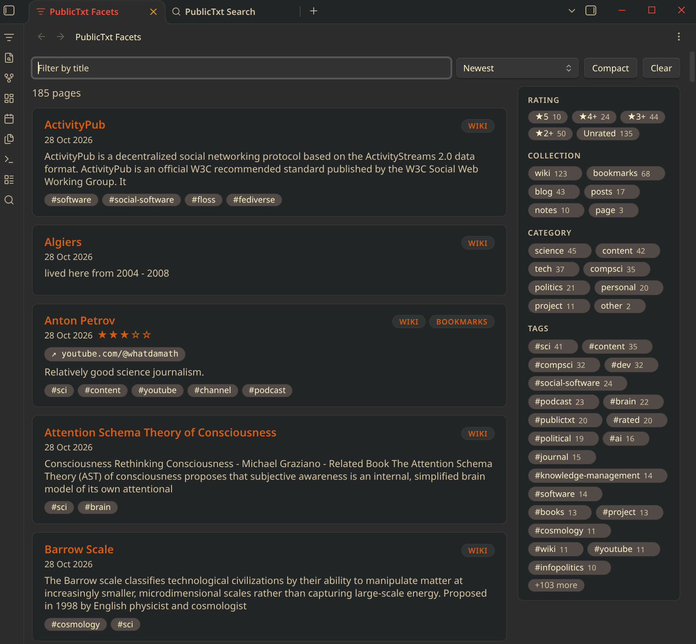
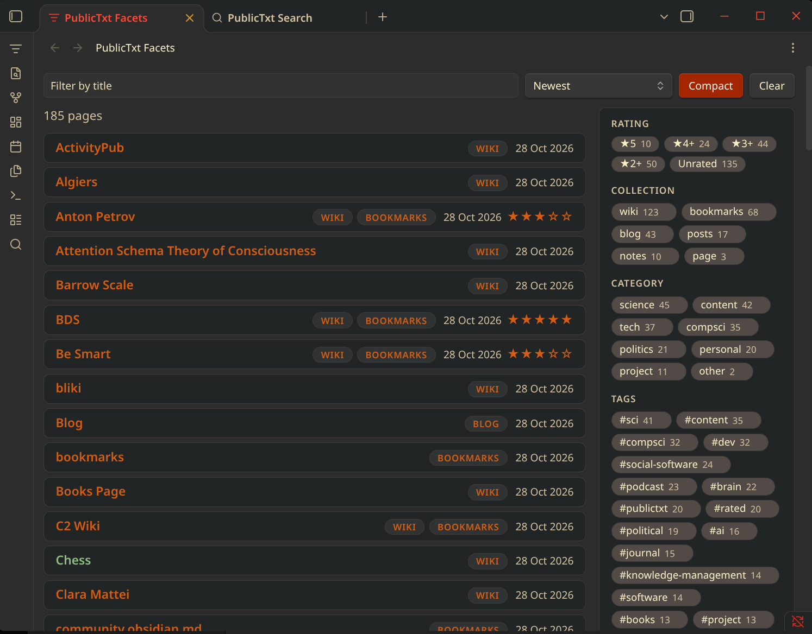
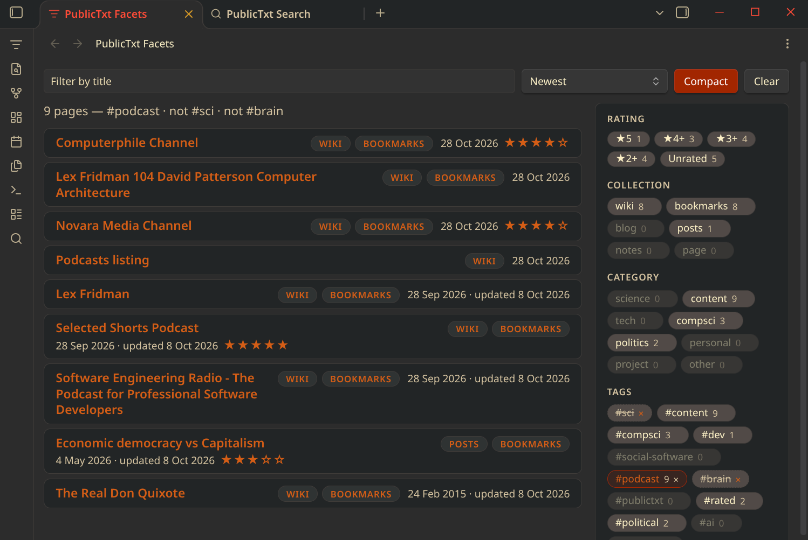
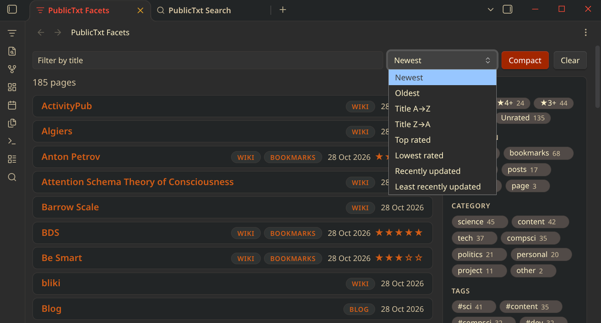
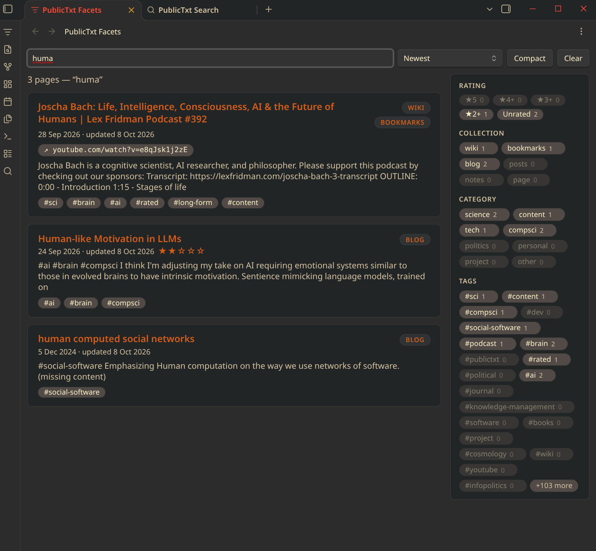
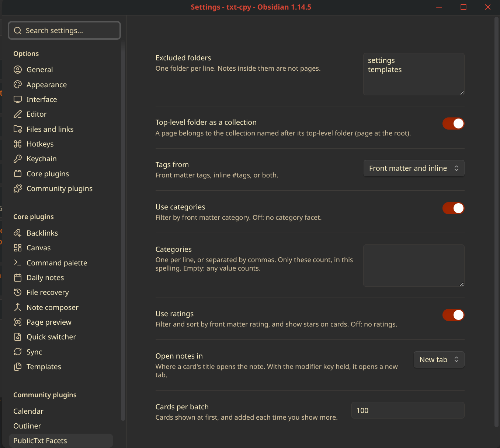
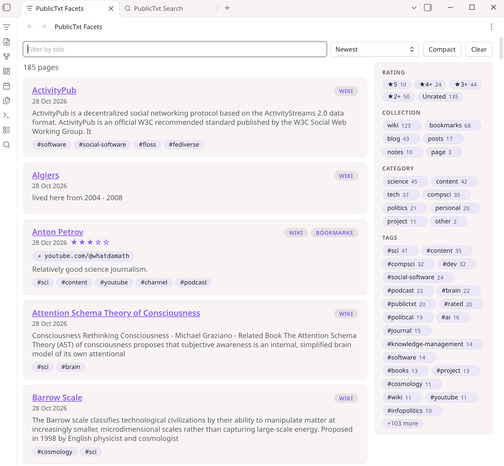

# PublicTxt Facets

Browse any vault by collection, category, tag and rating. Click chips to include or exclude
values, watch the counts change as you go, and read the results as cards sorted by date, title
or rating.





It shares the concepts of [PublicTxt-Pages](https://github.com/publictxt/publictxt-pages)' browse lists and search page, so it suits a PublicTxt repository written in Obsidian. Nothing requires PublicTxt conventions, though: it works in any vault.

## Using it

Open the view from the ribbon (the filter icon) or the command **PublicTxt Facets: Open**.



- **Chips.** Each collection, category and tag value is a chip. Click a chip to include it,
  click its ✕ to exclude it, click again to clear it.
- **All or any.** Once a facet has two or more values included, a toggle chooses whether pages
  must have all of them or any of them. Excluded values always remove pages.
- **Counts.** A chip's number is how many pages it would leave you with, given your other
  filters. Chips keep their order as you click, and zero-count chips are dimmed rather than
  hidden.
- **Rating.** Pick one: 5 to 1 stars means "at least this many", or *unrated*.
- **Title filter.** The text box keeps pages whose title contains what you type.
- **Sort.** Newest (the default), Oldest, Title A→Z and Z→A, Recently and Least recently updated, Top and Lowest rated. Unrated content is given a rating of 2.5 so it appears between rating 2 and 3 in sort order.
- **Cards.** Each card shows the title, collections, dates, rating, a summary, tags and bookmark links. Click the title to open the note, Ctrl/Cmd-click for a new tab, and hover for Page Preview. Click a card's tag to filter by it. **Compact** shows one line per card.
- **Clear** resets every filter and the sort.





The view remembers its filters with the workspace, and follows your edits: notes you create,
change, rename or delete update the results as you write.

## Where page data comes from

Every Markdown note is a page, except notes in excluded folders, `README.md`, `LICENSE.md`,
`CONTRIBUTING.md`, and notes with `publish: off` in their front matter.

| Field | From |
|---|---|
| Title | front matter `title`, else the first `# heading`, else the file name |
| Collections | the note's top-level folder (`page` at the root), front matter `collections`, and `bookmarks` if it has a bookmark URL |
| Categories | front matter `category` or `categories` |
| Tags | front matter `tags` and inline `#tags` |
| Rating | front matter `rating`, a whole number 1 to 5 |
| Created | front matter `created` or `date`, else a date in the file name or path, else the file's creation time |
| Updated | front matter `updated` or `lastmod`, else the file's modification time |
| Bookmarks | front matter `bookmark` or `bookmarks` (web links) |

Values are matched without regard to case. A vault without any of these still works: pages fall
back to file names and file times, and facets with no values don't appear.

## Commands

| Command | What it does |
|---|---|
| Open | Opens the view, or focuses it |
| Filter by this tag | Shows pages with the tag under the cursor (inline or in front matter) |
| Show pages like this one | Shows pages that share the current note's collections and tags |
| Clear | Resets the view's filters and sort |

None has a default hotkey. Set one in **Settings → Hotkeys**.

## Settings

| Setting | Default |
|---|---|
| Excluded folders | none |
| Top-level folder as a collection | on |
| Tags from | front matter and inline |
| Use categories | on |
| Categories | empty: any value counts. List yours to count only those |
| Use ratings | on |
| Open notes in | current tab |
| Cards per batch | 20 |



## Compatibility and privacy

- Obsidian 1.13 or later, on desktop and mobile.
- Colours come from your theme, light or dark.
- Read-only: it never changes your notes.
- No network access and no telemetry. Nothing leaves your vault.



## Development

```sh
npm install
npm run dev               # rebuild main.js on change
npm run build             # type-check and minified build
npm test                  # Node 22.18+
npm run lint
npm run deploy [-- <vault>]   # build and copy into <vault>/.obsidian/plugins/publictxt-facets/
```

`deploy` defaults to the test vault at `../../test-vaults/txt-cpy`. Design notes are in `docs/`:
`intent.md` (why), `spec.md` (what), and `naming.md` (names and vocabulary).

## License

GPL-3.0. See `LICENSE`.
